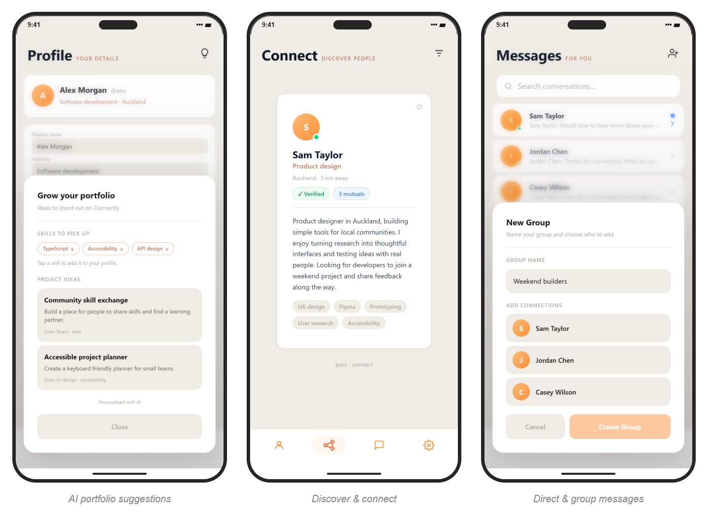

# Connectly

A networking app we built as a team for software development practice (COMP602) at AUT. Find people with shared interests, connect, and keep the conversation going through messages and voice or video calls.

<br>

<p align="center">
  
</p>

<br>

We worked in two scrum sprints, using Trello for user stories, priorities, sprint backlogs and acceptance checks. Planning poker helped us estimate work, while standups and retrospectives kept us coordinated. We planned the design with UI mockups and UML diagrams, tracked testing against a shared definition of done, and brought our work together through git branches and pull requests.

## Features

- Login, onboarding and two factor verification.
- Custom matching algorithm with swipe discovery and filters.
- Direct and group messaging, voice and video calls.
- AI suggestions for skills and projects.
- Profile analytics and connection statistics.
- Installable web app with PWA support.

## Running locally

You'll need java 21, Node.js 22 and Docker.

Copy `.env.example` to `.env`, `backend/.env.example` to `backend/.env`, and `frontend/.env.example` to `frontend/.env.local`. These defaults use a local database; use your own credentials for any external services.

Start the database from the repository root:

```sh
docker compose up -d
```

Start the backend:

```sh
cd backend
./gradlew bootRun
```

On Windows, use `./gradlew.bat bootRun`. In another terminal, start the frontend:

```sh
cd frontend
npm ci
npm run dev
```

Open `http://localhost:5173`. Email verification needs SendGrid configured for the sender in `OtpService.java`; portfolio suggestions need a Groq key. Both keys belong in `backend/.env`.

## Contributors

<table>
  <tr>
    <td align="center" width="100">
      <a href="https://github.com/fatehbhular"></a>
    </td>
    <td width="210">
      <a href="https://github.com/fatehbhular"><strong>Fateh Bhular</strong></a><br>
      <sub>Product owner</sub>
    </td>
    <td width="690">Direct messaging, voice &amp; video calls<br>App setup, online status &amp; UI theme</td>
  </tr>
  <tr>
    <td align="center" width="100">
      <a href="https://github.com/ShawnLeeyz"></a>
    </td>
    <td width="210">
      <a href="https://github.com/ShawnLeeyz"><strong>Shawn Lee</strong></a><br>
      <sub>Scrum master</sub>
    </td>
    <td width="690">Email OTP, two factor verification &amp; password recovery<br>Password hashing &amp; swipe controls</td>
  </tr>
  <tr>
    <td align="center" width="100">
      <a href="https://github.com/LeoCaoProjects"></a>
    </td>
    <td width="210">
      <a href="https://github.com/LeoCaoProjects"><strong>Leo Cao</strong></a><br>
      <sub>Developer</sub>
    </td>
    <td width="690">Login &amp; accounts, matching algorithm &amp; group chats<br>AI suggestions, PWA support &amp; UI design</td>
  </tr>
  <tr>
    <td align="center" width="100">
      <a href="https://github.com/SrikarKurani"></a>
    </td>
    <td width="210">
      <a href="https://github.com/SrikarKurani"><strong>Srikar Kurani</strong></a><br>
      <sub>Developer</sub>
    </td>
    <td width="690">Profile editing &amp; discovery filters<br>Analytics &amp; user blocking</td>
  </tr>
</table>
